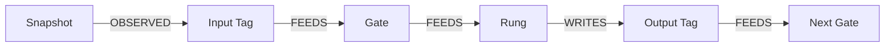

# Interlock Tracer

An offline tool for explaining why a PLC output is blocked. It builds a Relate graph from a limited Structured Text program and a snapshot of input states, evaluates the logic deterministically, and returns traceable evidence paths. The bundled Line 3 data is synthetic.

## Use case

A maintenance engineer asks why conveyor motor M101 will not start. In the sample, the answer depends on several interlocks across safety and conveyor programs. Interlock Tracer shows the contributing inputs and their paths through the logic. It does **not** issue repair instructions or control equipment.

## How it uses Relate

Each project version has its own local, embedded Relate directory store. Tags, expression gates, rungs and snapshots are connected with FEEDS, WRITES and OBSERVED edges. Expressions are reconstructed from the graph, not re-parsed from stored source. Relate full-text indexing supports German and English tag searches; bounded `SHORTEST` graph traversal shows possible downstream impact and supports version dependency comparisons. Query interfaces open stores read-only. The optional trace recorder writes to a separate store.



`why` uses deterministic three-valued Boolean evaluation. A missing input or unsupported expression yields `INCOMPLETE` when it prevents a verdict. Cycles use the snapshot value when a tag is revisited. An optional read-only MCP interface and Claude tool-use client expose the same computations.

## Setup and run

Python 3.11 or newer. From this directory:

```bash
uv venv
uv pip install -p .venv -e '.[mcp,ai,dev]'
.venv/bin/itrace demo
```

The demo requires no network or API key after installation. It rebuilds the two sample stores under `data/stores/` and writes `data/why_M101_RUN.html`. Open the HTML in a browser for a self-contained offline graph. Existing stores at those demo paths are replaced; use separate paths for your own data.

```bash
.venv/bin/itrace why M101_RUN --snapshot s1_m101_wont_start --store data/stores/line3_v1.3 --html data/verdict.html
.venv/bin/itrace impact GUARD_DOOR_2_CLOSED --store data/stores/line3_v1.3
.venv/bin/itrace find 'Schutztür 2' --store data/stores/line3_v1.3
.venv/bin/itrace diff --old data/stores/line3_v1.3 --new data/stores/line3_v1.4
.venv/bin/itrace eval
.venv/bin/itrace why M101_RUN --snapshot s1_m101_wont_start --store data/stores/line3_v1.3 --record data/traces
```

For MCP, install the `mcp` extra, run the demo first, and adapt the absolute paths in `.mcp.json.example` for your client. Start manually with `.venv/bin/python -m interlock_tracer.mcp_server`. Tools are read-only. For optional Claude explanations, install the `ai` extra, set `ANTHROPIC_API_KEY`, optionally set `ITRACE_MODEL`, and run `.venv/bin/itrace ask 'Why is M101 blocked?' --snapshot s1_m101_wont_start`. Claude requires network access and may incur API charges; the graph engine does not require Claude. Model availability depends on your Anthropic account.

## Where the data lives

`examples/line3/v1.3` and `v1.4` contain project metadata, I/O list, logic and snapshots. Generated stores and the HTML viewer go under `data/`. `eval/questions.json` contains 30 curated synthetic scenarios. The local evaluation measures agreement with those example expectations only; it is not a real-world accuracy claim.

## Questions it answers

| Command | Question |
|---|---|
| `why` | Which observed conditions contribute to this output being blocked? |
| `impact` | Which outputs can a tag potentially reach in the logic graph? |
| `diff` | Which logic and input dependencies changed between versions? |
| `find` | Which tag matches an English or German description? |

Impact describes connectivity, not a prediction that a fault will occur. `--json` is supported on `why`, `impact`, `find` and `diff`.

## Limits — not a safety system

Only a Boolean subset of IEC 61131-3 Structured Text is supported; unsupported constructs are explicitly unresolved. There is no live PLC connectivity, ladder logic, timers or counters, and no authorization to bypass interlocks. Snapshot values must be provided by the user. This is a research prototype using synthetic data, not a substitute for qualified personnel, plant procedures, or a certified safety system.

## Related approaches

PLC cross-reference tools and plant knowledge graphs can also trace dependencies. This prototype combines a graph representation of Boolean expressions, deterministic snapshot evaluation, explicit abstention and an optional grounded language interface. No claim of absolute novelty or production validation is made.

## AI and third-party disclosure

Project notes describe earlier AI-assisted development with Claude Code; subsequent implementation and review used OpenAI Codex. The optional Claude API provides language explanations at runtime; its output is not the deterministic verdict. Third-party dependencies include Relate, Cytoscape.js (MIT; notice in `src/interlock_tracer/vendor/`), the MCP SDK and Anthropic SDK. Project code is licensed under MIT; third-party packages retain their own licenses.
